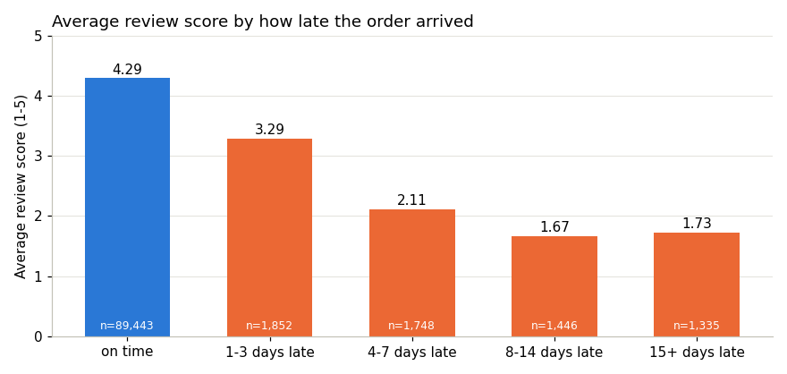
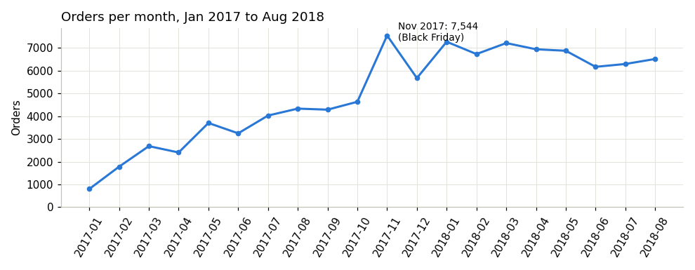
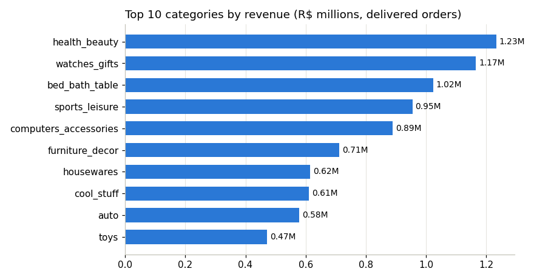
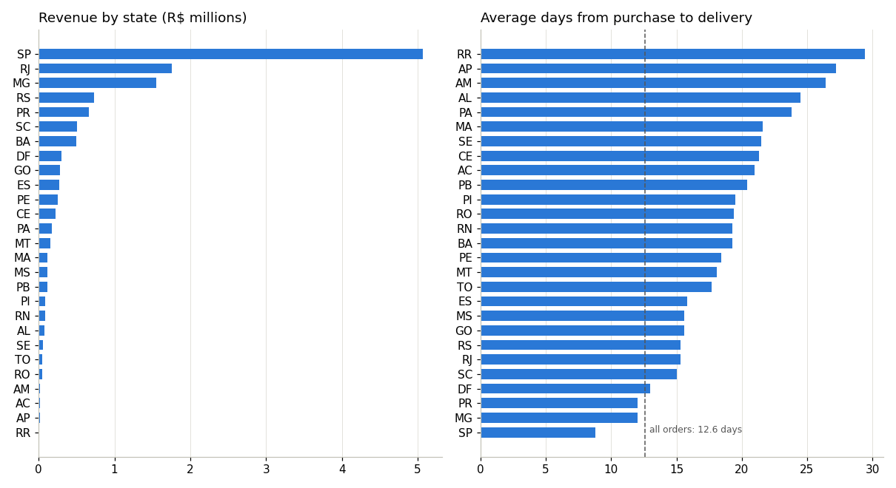

# Olist e-commerce analysis (SQL + Python)

An analysis of about 99,000 orders from Olist, a Brazilian online marketplace, using SQL (SQLite) inside a Python notebook. The aim was to answer five questions a business team at Olist might ask, and to find out what drives bad customer reviews.

## Business questions

1. How many orders are there, what happens to them, and how has volume changed over time?
2. Which product categories bring in the most revenue?
3. Do late deliveries get lower review scores?
4. What share of customers come back and order again?
5. How do revenue and delivery time vary by state?

## Key findings

**Late deliveries are the clearest driver of bad reviews.** 6.7% of delivered orders arrived after the estimated date. Those orders averaged 2.27 stars out of 5, against 4.29 for orders that arrived on time, and 62% of late orders got 1 or 2 stars (compared with 9% of on-time orders). Even 1 to 3 days late pulls the average down to 3.29.



- **Orders:** 99,441 orders, 97.0% delivered and 0.6% cancelled. Monthly orders grew from 800 in January 2017 to 6,000 to 7,300 a month in 2018. The busiest month was November 2017 (7,544 orders, Black Friday).
- **Revenue:** R$ 13.2 million in item revenue from delivered orders across 74 categories. Health and beauty (R$ 1.23M), watches and gifts (R$ 1.17M) and bed, bath and table (R$ 1.02M) lead. The top 10 categories are 62.4% of revenue.
- **Repeat customers:** only 3.1% of 96,096 customers ordered more than once, so the business relies almost entirely on new buyers.
- **Geography:** São Paulo state is 38.3% of revenue and gets the fastest deliveries (8.8 days on average against 12.6 overall). Northern states such as Roraima, Amapá and Amazonas wait 26 to 29 days.





## What I would recommend to Olist

- Set delivery estimates that the carrier can actually meet, and tell customers early when an order will be late. Lateness hurts ratings more than anything else in the data.
- Test something that brings first-time buyers back (a follow-up offer after a good delivery), since repeat purchase is very low.
- Look at warehouses or carriers serving the north and north-east, where delivery takes two to three times longer than in São Paulo.

## Tools

- **SQLite** for storing the nine CSV files as tables and answering each question with SQL (joins, `GROUP BY`, `CASE WHEN`, common table expressions with `WITH`)
- **Python**: pandas to load the CSVs and hold query results, matplotlib for charts
- **Jupyter notebook** in VS Code

## How to run it

1. Download the [Brazilian E-Commerce Public Dataset by Olist](https://www.kaggle.com/datasets/olistbr/brazilian-ecommerce) from Kaggle and unzip the CSV files into a folder called `data/` inside this repo.
2. Install the packages:
   ```
   pip install pandas matplotlib ipykernel
   ```
3. Open `olist_analysis.ipynb` and run all cells. The first cell builds `data/olist.db` from the CSV files.

The `data/` folder is in `.gitignore`, so the raw data is not stored in this repo.

## Limitations

- The late-delivery result is an association. Late orders might differ in other ways (region, product type), although the steady drop in score with each extra day late makes lateness the most likely cause.
- The data covers about two years, which understates repeat purchasing.
- Revenue uses item prices only and leaves out freight charges.
